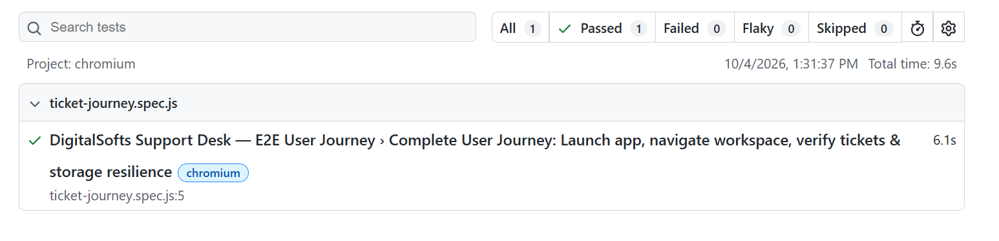

# 🎫 DigitalSofts Support Desk
A modern, production-grade ERP Support & Ticket Lifecycle Management platform built for **DigitalSofts** using **React (Vite)**, **LocalStorage**, **Node.js/Express**, and **Prisma ORM**.
---
## 📌 Project Overview
### What Problem Does This Application Solve?
In fast-growing organizations, customer support requests often get scattered across emails, chat channels, and internal messages. This results in:
- Unclear ownership of customer issues.
- Breached Service Level Agreements (SLAs).
- Lack of visibility into support agent workloads and resolution metrics.
- High response latency and frustrated customers.
**DigitalSofts Support Desk** solves this by providing a unified, real-time command center where teams can triage, assign, track, automate, and resolve tickets efficiently—backed by automated SLA tracking, executive reports, and an AI-driven command assistant.
---
## 🌐 Quick Links & Demo
- **Live Demo:** [https://digitalsofts-support-desk.vercel.app](https://digitalsofts-support-desk.vercel.app)
- **Repository:** [https://github.com/YOUR_USERNAME/ticket-management-system](https://github.com/YOUR_USERNAME/ticket-management-system)
---
## ✨ Features
- **📊 Real-Time Executive Dashboard**: High-level KPIs, open/pending/resolved counters, SLA breach alerts, and dynamic activity audit trail.
- **🎯 Comprehensive Ticket Lifecycle**:
  - Multi-parameter search & filtering (`status:open`, `priority:critical`, `assigned:kiran`).
  - Slide-over detail drawer for fast review.
  - Public customer replies vs. private internal agent notes.
  - Tag management, attachment handling, and audit history.
- **📈 Executive Reports & Export**:
  - Live metric breakdown by department, agent, channel, and priority.
  - One-click **CSV data export**.
  - Formatted, print-ready **Save as PDF** report generation.
- **👥 Workspace Operations Management**: Full CRUD directory for **Customers**, **Agents**, **Teams**, and **Departments**.
- **⚡ Automation & SLA Engine**: Custom trigger rules for SLA risk alerts and automated agent/manager assignment.
- **✦ AI Workspace Assistant & Command Box**: Natural language answering for workspace inquiries and instant keyboard command execution.
- **⚙️ Centralized Operations & Settings**: Global configurations for brand identity, SLA defaults, Slack webhooks, session timeouts, and **Full System JSON Backup & Restore**.
- **🛡️ Dual-Layer Resilience**: Live REST API syncing with automatic `localStorage` fallback to guarantee zero UI downtime.
---
## 🛠️ Tech Stack
### Frontend
- **Core**: React 18, Vite
- **Routing**: React Router DOM (v6)
- **Forms & Validation**: React Hook Form, Zod
- **Data Visualization**: Recharts / Metric Cards
- **Styling**: Tailwind CSS & Modern Custom Design System
### Backend & Database
- **Runtime**: Node.js & Express
- **API Standard**: RESTful architecture (`/api/v1/`)
- **Database**: SQLite (local) / MySQL & Prisma ORM
- **Security**: Helmet, CORS, Express-Rate-Limit, UUID Request Tracing
### Testing & Quality Assurance
- **Unit & Integration Testing**: Node Native Test Runner / Vitest
- **End-to-End (E2E) Testing**: Playwright
---
## 🚀 Installation & Setup
### 1. Prerequisites
- Node.js (v18.x or higher)
- Git
### 2. Clone & Install
```bash
git clone https://github.com/YOUR_USERNAME/ticket-management-system.git
cd ticket-management-system
npm install
```
  
3. Run Frontend

  
```bash
npm run dev
```
  

Open http://localhost:5173 in your browser.


  
4. Run Backend Server (Optional)

  
```bash
cd server
npm install
npm run dev
```
  

Server runs at http://localhost:4000/api/v1.


  

  
🧪 Automated Testing & Quality Assurance

  
1. Frontend Command & Automation Tests

  
```powershell
node --test tests/unit/automationEngine.test.js tests/unit/workspaceCommand.test.js tests/unit/workspaceCommandActions.test.js
```
  

  

Result: 14 passed, 0 failed (PASS)


  

  
2. Backend API Integration Tests

  
```powershell
npm --prefix server test
```
  

  

Result: 6 passed, 0 failed (PASS)


  

  
3. Production Frontend Build

  
```powershell
npm run build
```
  

  

Result: Passed (38 modules transformed, built in ~900ms)


  

  
4. Playwright End-to-End (E2E) Test Report

  
```powershell
npx playwright test tests/e2e/ticket-journey.spec.js
```
  

  

Result: 1 passed, 0 failed (100% PASS)


  

  
Report Location: playwright-report/index.html

  
View Report Locally: npx playwright show-report

  

  

  

  
📸 Playwright Report Preview

  




  